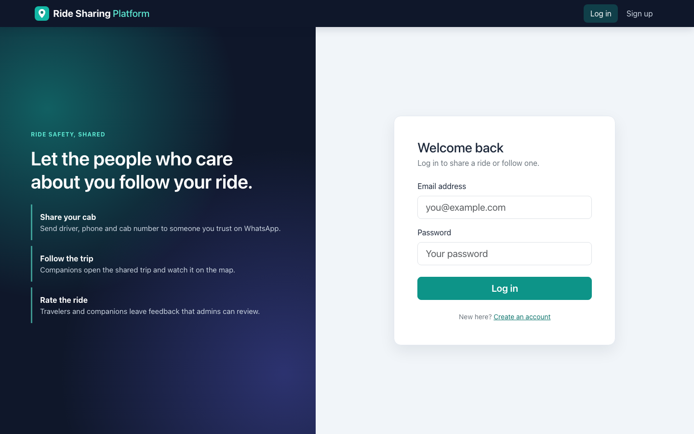
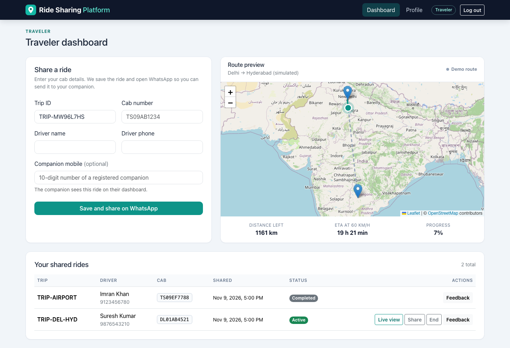
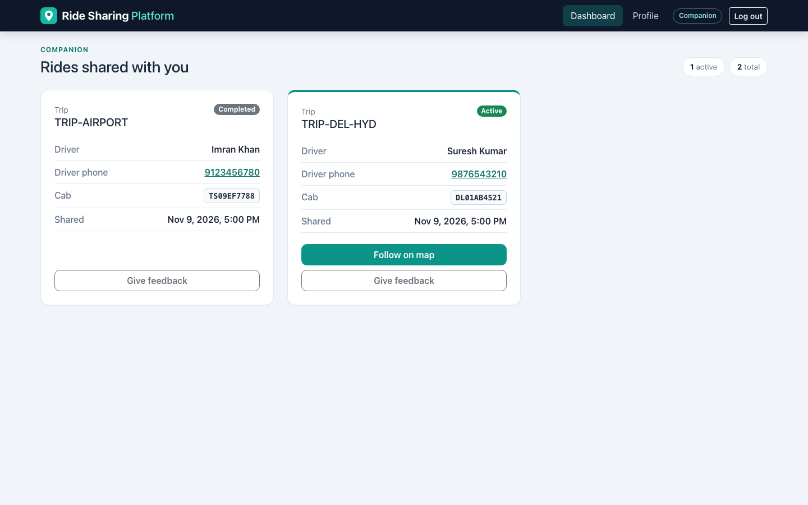
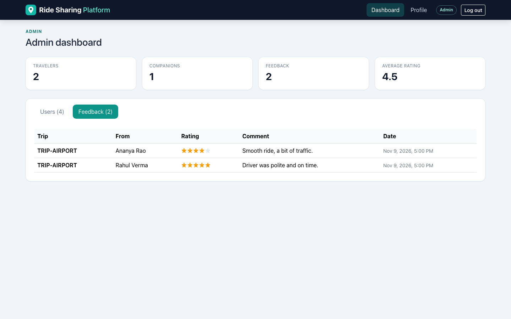

# Ride-Sharing Platform: Frontend

React client for a ride-safety sharing app: travelers share their cab details over WhatsApp, companions follow the trip on a map, and admins review users and feedback.


## Live demo

https://ride-sharing-platform-frontend.vercel.app

## Overview

This is the standalone frontend of the Ride-Sharing Platform, built with Create React App. It talks to the [backend API](https://github.com/VamsiKrishnaThota03/ride-sharing-platform-backend) over REST and an authenticated WebSocket.

### Related repositories

| Repository | What it contains |
|------------|------------------|
| [ride-sharing-platform-frontend](https://github.com/VamsiKrishnaThota03/ride-sharing-platform-frontend) | **This repo**: the React client, deployed on Vercel |
| [ride-sharing-platform-backend](https://github.com/VamsiKrishnaThota03/ride-sharing-platform-backend) | Express + PostgreSQL + WebSocket API used by this client |
| [Ride-Sharing-Platform](https://github.com/VamsiKrishnaThota03/Ride-Sharing-Platform) | Monorepo with the same frontend and backend together |

## Screenshots

| Log in | Traveler dashboard |
| --- | --- |
|  |  |

| Companion dashboard | Admin: feedback |
| --- | --- |
|  |  |

Screenshots were taken locally with sample data (SQLite development database).

## Features

**All users**
- Sign up as a **Traveler** or a **Companion** and log in. The JWT is kept in `localStorage`; expired tokens send you back to the login page, and each role only sees its own dashboard.
- Profile page with an edit form (changing your email or mobile number logs you out so the token is refreshed).

**Traveler** (`/traveler-dashboard`)
- Share-ride form (trip ID, driver name, driver phone, cab number, optional companion mobile). The ride is saved through the API, then WhatsApp (`wa.me`) opens with the details and a link to the trip. If the browser blocks the pop-up, a **Send details on WhatsApp** button is shown.
- Ride history with status, a live-view link, a re-share link, **End** to mark a ride completed, and inline 1-5 star feedback.
- Opening a trip (`/traveler-dashboard?tripId=...`) starts the trip simulation and streams the position to the companion over the WebSocket.

**Companion** (`/companion-dashboard`)
- Cards for every ride shared with your mobile number, refreshed every 10 seconds. A ride is *Active* until the traveler ends it or 60 minutes pass.
- **Follow on map** for active rides: the map follows the traveler's position when the traveler has the trip open.
- Notifications from the server when a trip is getting close to its destination and when it is complete.
- Inline 1-5 star feedback.

**Admin** (`/admin-dashboard`)
- Totals (travelers, companions, feedback, average rating), a users table and a feedback table.
- Admin accounts cannot be created from the sign-up form; the backend grants the admin role to the emails in `ADMIN_EMAILS`.

### About the map

The trip is a **simulation**: the marker moves in a straight line from Delhi to Hyderabad in about a minute (Leaflet with OpenStreetMap tiles). It does not use the device's GPS. Distance and ETA (at 60 km/h) are worked out from the simulated position.

## Tech stack

- React 18 (Create React App / `react-scripts` 5), React Router 6
- Axios, `jwt-decode`
- Leaflet + react-leaflet with OpenStreetMap tiles
- Bootstrap 5 with a custom theme (`src/index.css`)
- Jest + React Testing Library

## Project structure

```
src/
├── App.js                    # routes and role guards
├── config.js                 # backend / frontend URLs, ride expiry
├── utils/                    # auth session, geo helpers, ride status
└── components/
    ├── Login.js, Signup.js, AuthCard.js
    ├── Navbar.js, Profile.js
    ├── TravelerDashboard.js  # share form, route preview, ride history, live trip view
    ├── TravelerMap.js        # Leaflet map, simulation, trip WebSocket
    ├── RideSharingForm.js    # saves a ride and builds the WhatsApp message
    ├── RideHistory.js, FeedbackForm.js
    ├── CompanionDashboard.js
    └── AdminDashboard.js
```

### Routes

| Path | Access | Page |
| --- | --- | --- |
| `/` (`/login`), `/signup` | Public | Authentication |
| `/traveler-dashboard` | Logged in (sharing: travelers) | Share rides, history; `?tripId=` opens the live trip |
| `/companion-dashboard` | Companions | Rides shared with you |
| `/admin-dashboard` | Admins | Users and feedback |
| `/profile` | Logged in | View and edit your profile |
| `/map` | Logged in | Route preview only |

## Getting started

```bash
git clone https://github.com/VamsiKrishnaThota03/ride-sharing-platform-frontend.git
cd ride-sharing-platform-frontend
npm install
cp .env.example .env     # point it at your backend
npm start                # http://localhost:3000
```

| Command | Description |
| --- | --- |
| `npm start` | Dev server |
| `npm run build` | Production build into `build/` |
| `npm test` | Tests |

You need the [backend](https://github.com/VamsiKrishnaThota03/ride-sharing-platform-backend) running; it can use a local SQLite file for development.

### Environment variables

| Variable | Required | Description |
|----------|----------|-------------|
| `REACT_APP_BACKEND_URL` | No | API base URL. Defaults to `http://localhost:5001` in development and `https://ride-sharing-platform-backend.onrender.com` in production builds. The WebSocket URL is derived from it |
| `REACT_APP_FRONTEND_URL` | No | Public URL used in shared WhatsApp links. Defaults to the site's own origin |

`REACT_APP_*` values are read at build time, so restart `npm start` (or redeploy) after changing them.

## Deployment notes (Vercel)

- Set `REACT_APP_BACKEND_URL` if the API is not at the default Render URL, and `REACT_APP_FRONTEND_URL` to the public site URL (optional, it defaults to the current origin).
- The backend must allow the Vercel domain in `CORS_ORIGIN` if it restricts origins.
- This version needs the updated backend: the WebSocket now requires a token, and the companion and feedback routes check roles.

## Known limitations

- The trip map is a simulated Delhi to Hyderabad route, not real GPS tracking, and the simulation restarts when the page is reloaded.
- Companions only get live positions while the traveler has the trip page open; otherwise they see the simulation.
- Companions are matched by mobile number, so the traveler must enter the number the companion registered with.
- Rides show as completed 60 minutes after they were shared, even if nobody ended them.
- JWTs live in `localStorage` and expire after one hour; there is no refresh token or rate limiting on login.
- `npm audit` still reports issues inside `react-scripts` (Create React App) and Sequelize's `uuid` dependency that need breaking upgrades.


## Contact

Thota Vamsi Krishna — [GitHub](https://github.com/VamsiKrishnaThota03)
